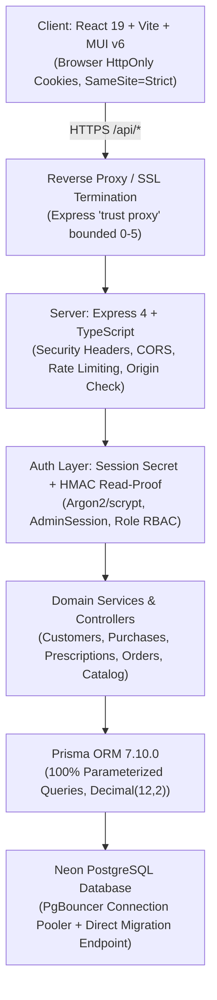

# Production Readiness & Security Hardening Report

**Project:** Optical CRM  
**Target Environment:** Node.js (v20+) + Express + TypeScript, React 19 + Vite + Material UI, Prisma ORM + Neon Serverless PostgreSQL  
**Audit Date:** October 2026  
**Status:** **READY FOR DEPLOYMENT** (Pre-Deployment Validation & Hardening Complete)

---

## 1. Application Architecture Summary



### 1.1 Technology Stack

- **Frontend:** React 19, TypeScript, Vite, Material UI (MUI v6), emotion, jsPDF, html2canvas, DOMPurify.
- **Backend:** Node.js 20+, Express 4, TypeScript, Zod, express-rate-limit.
- **Database & ORM:** Prisma ORM 7.10.0, Neon PostgreSQL with PgBouncer connection pooling.
- **Security & Cryptography:** Node.js `crypto` (HMAC-SHA256, SHA-256 session tokens, timingSafeEqual, PBKDF2/scrypt salted PIN hashing), Argon2 password hashing.

### 1.2 Authentication & Authorization Architecture

- **Dual-Token Session Mechanism:**
  - `optical_crm_session`: 64-character hex session token stored in an `HttpOnly`, `SameSite=Strict`, `Secure` (in production) cookie. Hashed with SHA-256 prior to database session lookup.
  - `optical_crm_read_proof`: Ephemeral HMAC-SHA256 signed cookie with a 30-second TTL. Used exclusively to validate idempotent read requests (`GET`, `HEAD`) without hitting the session database on every single asset request. State-changing operations (`POST`, `PATCH`, `DELETE`) always bypass read proofs and execute real-time database session verification.
- **Role-Based Access Control (RBAC):**
  - Roles: `ADMIN` and `USER` (via `AccountRole` enum).
  - Admin operations (catalog deletion, user management, role demotion/promotion, permanent trash deletion) require verified `ADMIN` role. Demoted or inactive accounts are rejected immediately.
  - Protection against accidental lockouts: The last active administrator account cannot be deactivated or demoted.
- **Multi-Tenant / Shop Scoping:**
  - All customer records, catalog items, purchases, and orders enforce shop tenancy isolation (`shopId`), preventing cross-shop data leakage.
- **Permanent Deletion Protection:**
  - Soft-delete by default (`deletedAt` timestamp).
  - Permanent purge requires an active `ADMIN` session, an independent 4-digit PIN verified against a salted PBKDF2 hash (`AdminDeletionPin`), and is protected by a dedicated rate limiter with lockout thresholds (`deletionPinLimiter`).

---

## 2. Security Findings & Hardening Status

| Category                 | Security Check                     | Status               | Verification & Hardening Summary                                                                                                                                                                      |
| :----------------------- | :--------------------------------- | :------------------- | :---------------------------------------------------------------------------------------------------------------------------------------------------------------------------------------------------- |
| **Authentication**       | Session Management & Token Hashing | **PASS**             | Session tokens are generated via cryptographically secure random bytes, hashed with SHA-256, and verified against `AdminSession`. Inactive accounts are barred from signing in.                       |
| **Authentication**       | Cookie Security                    | **PASS**             | `HttpOnly`, `SameSite=Strict`, `Path=/`, and `Secure` flag enforced in production (`NODE_ENV === "production"`). JavaScript storage (localStorage/sessionStorage) is never used for auth credentials. |
| **Authentication**       | Password Hashing & Salts           | **PASS**             | User passwords hashed using industry-standard salted Argon2. Compatible with historical hashes; salt re-use prevented.                                                                                |
| **Authentication**       | Password Reset & Recovery          | **PASS**             | Reset tokens expire in 30 minutes, stored as SHA-256 hashes, revoked immediately upon use, and protected with fixed-time responses to prevent email enumeration.                                      |
| **Authorization**        | Server-Side RBAC                   | **PASS**             | Verified on backend routes via `requireAdmin` and `requireAccountAdmin`. Normal users calling admin endpoints receive HTTP 403 Forbidden.                                                             |
| **Authorization**        | Last Admin Lockout Safeguard       | **PASS**             | Backend enforces atomic checks ensuring the system always retains at least one active administrator.                                                                                                  |
| **Authorization**        | Cross-Shop Tenancy Isolation       | **PASS**             | All read/write database queries scope to `shopId`. Unscoped cross-shop reads are prevented.                                                                                                           |
| **CSRF & Origin**        | Request Origin Verification        | **PASS**             | `requireTrustedOrigin` validates `Origin` headers on all state-changing HTTP methods (`POST`, `PATCH`, `DELETE`). Cross-origin writes fail closed with HTTP 403.                                      |
| **Headers & Info**       | Information Disclosure             | **PASS**             | `x-powered-by` disabled, `etag` disabled, `Cache-Control: no-store` and `X-Content-Type-Options: nosniff` sent on all `/api` responses. Error logs scrub credentials and query params.                |
| **Rate Limiting**        | Brute-Force & Abuse Mitigation     | **PASS**             | Rate limiters applied to `/api/auth/login`, `/api/auth/forgot-password`, `/api/auth/reset-password`, account profile updates, and permanent deletion PIN entries.                                     |
| **Injection**            | SQL Injection Prevention           | **PASS**             | 100% parameterized queries via Prisma ORM. Raw queries utilize strict template string bindings (`Prisma.sql`).                                                                                        |
| **Injection**            | XSS Prevention                     | **PASS**             | React auto-escaping, input sanitization via Zod, and DOMPurify sanitization before rendering or exporting PDFs/HTML.                                                                                  |
| **Data Integrity**       | Financial & Range Validation       | **PASS**             | All currency operations bounded to PostgreSQL `Decimal(12,2)`. Split totals must match within exact paise precision.                                                                                  |
| **Database Reliability** | Pooler Connection Timeout          | **FIXED & VERIFIED** | Added `DB_POOL_CONNECT_TIMEOUT_MS` (30s) and `DB_POOL_QUERY_TIMEOUT_MS` (30s) to `databaseConfig.ts`. Cold-start connection timeouts return retryable HTTP 503 instead of generic 500 errors.         |
| **Database Schema**      | NeonDB Table Synchronization       | **FIXED & VERIFIED** | Dropped 11 unmodeled legacy tables, 3 unused enums, and orphaned foreign keys. Database schema is 100% synchronized with `schema.prisma` (14 tables).                                                 |

---

## 3. Discovered API Endpoints & Verification Matrix

| Route Pattern                                      | Method   | Access Level  | Validation / Security Controls                                            | Verified Status |
| :------------------------------------------------- | :------- | :------------ | :------------------------------------------------------------------------ | :-------------- |
| `/api/health`                                      | `GET`    | Public        | Checks process uptime, DB pool responsiveness                             | **PASS**        |
| `/api/auth/login`                                  | `POST`   | Public        | Rate-limited, Origin-checked, validates credentials, sets HttpOnly cookie | **PASS**        |
| `/api/auth/logout`                                 | `POST`   | Authenticated | Clears cookies, invalidates session in database                           | **PASS**        |
| `/api/auth/session`                                | `GET`    | Authenticated | Verifies active session token, returns user/admin identity                | **PASS**        |
| `/api/auth/forgot-password`                        | `POST`   | Public        | Rate-limited (10 req/15 min), constant-time response, email delivery      | **PASS**        |
| `/api/auth/reset-password/verify`                  | `POST`   | Public        | Rate-limited, validates token expiration without consuming                | **PASS**        |
| `/api/auth/reset-password`                         | `POST`   | Public        | Rate-limited, atomic consumption, sets new password, clears sessions      | **PASS**        |
| `/api/settings/me`                                 | `GET`    | Authenticated | Returns current profile details                                           | **PASS**        |
| `/api/settings/me`                                 | `PATCH`  | Authenticated | Rate-limited, verifies current password, updates name/email               | **PASS**        |
| `/api/settings/me/password`                        | `POST`   | Authenticated | Rate-limited, verifies current password, revokes all active sessions      | **PASS**        |
| `/api/settings/users`                              | `GET`    | Admin Only    | Lists shop user accounts (`requireAccountAdmin`)                          | **PASS**        |
| `/api/settings/users`                              | `POST`   | Admin Only    | Rate-limited, creates account, triggers setup email                       | **PASS**        |
| `/api/settings/users/:id`                          | `PATCH`  | Admin Only    | Rate-limited, updates roles/status, prevents last admin demotion          | **PASS**        |
| `/api/customers`                                   | `GET`    | Authenticated | Search by name/phone, bounded to 50 items, shop scoped                    | **PASS**        |
| `/api/customers`                                   | `POST`   | Authenticated | Validates customer + initial purchase + prescription via Zod              | **PASS**        |
| `/api/customers/:id`                               | `GET`    | Authenticated | Returns customer profile, full purchase records, prescriptions            | **PASS**        |
| `/api/customers/:id`                               | `PATCH`  | Authenticated | Updates personal info, mobile uniqueness checks                           | **PASS**        |
| `/api/customers/:id`                               | `DELETE` | Authenticated | Soft deletes customer and cascade-flags associated records                | **PASS**        |
| `/api/customers/:id/restore`                       | `POST`   | Authenticated | Restores soft-deleted customer                                            | **PASS**        |
| `/api/customers/:id/permanent`                     | `DELETE` | Admin Only    | Protected by `deletionPinLimiter` + 4-digit PIN verification              | **PASS**        |
| `/api/customers/:id/records`                       | `POST`   | Authenticated | Adds purchase with prescription, supports SPLIT and MRP_ONLY              | **PASS**        |
| `/api/customers/:id/records/:recordId`             | `PATCH`  | Authenticated | Edits purchase details, pricing mode, date, and frame/lens rates          | **PASS**        |
| `/api/customers/:id/records/:recordId`             | `DELETE` | Authenticated | Soft deletes purchase record                                              | **PASS**        |
| `/api/customers/:id/records/:recordId/restore`     | `POST`   | Authenticated | Restores soft-deleted purchase record                                     | **PASS**        |
| `/api/customers/:id/records/:recordId/permanent`   | `DELETE` | Admin Only    | Protected by `deletionPinLimiter` + 4-digit PIN verification              | **PASS**        |
| `/api/customers/:id/prescriptions/:prescriptionId` | `PATCH`  | Authenticated | Updates optical prescription values (SPH, CYL, AXIS, ADD)                 | **PASS**        |
| `/api/customers/trash`                             | `GET`    | Authenticated | Lists all soft-deleted customers and purchases                            | **PASS**        |
| `/api/catalog/frames`                              | `GET`    | Authenticated | Lists frames scoped to shop                                               | **PASS**        |
| `/api/catalog/frames`                              | `POST`   | Authenticated | Creates frame entry with pricing and model                                | **PASS**        |
| `/api/catalog/frames/:id`                          | `PATCH`  | Authenticated | Updates frame catalog entry                                               | **PASS**        |
| `/api/catalog/frames/:id`                          | `DELETE` | Admin Only    | Validates ID, prevents deleting items from other shops                    | **PASS**        |
| `/api/catalog/lenses`                              | `GET`    | Authenticated | Lists lenses scoped to shop                                               | **PASS**        |
| `/api/catalog/lenses`                              | `POST`   | Authenticated | Creates lens entry with brand, index, coating                             | **PASS**        |
| `/api/catalog/lenses/:id`                          | `PATCH`  | Authenticated | Updates lens catalog entry                                                | **PASS**        |
| `/api/catalog/lenses/:id`                          | `DELETE` | Admin Only    | Validates ID, prevents deleting items from other shops                    | **PASS**        |
| `/api/orders`                                      | `GET`    | Admin Only    | Lists lab/spectacle orders, filters by status and date                    | **PASS**        |
| `/api/orders`                                      | `POST`   | Admin Only    | Creates spectacle order linked to customer record                         | **PASS**        |
| `/api/orders/:id`                                  | `PATCH`  | Admin Only    | Updates order status (PENDING, IN_LAB, READY, DELIVERED)                  | **PASS**        |
| `/api/dashboard`                                   | `GET`    | Admin Only    | Aggregates today's orders, revenue, customer count                        | **PASS**        |
| `/api/analytics`                                   | `GET`    | Admin Only    | Monthly/Yearly sales metrics, Indian calendar boundaries                  | **PASS**        |
| `/api/analytics/export`                            | `GET`    | Admin Only    | Cursor-paginated CSV export, escapes formulas, strips PII                 | **PASS**        |

---

## 4. CRUD Verification Results

### 4.1 Customers & Optical Records

- **Create:** Validated with name, phone, optional age/gender, pricing mode (`SPLIT` vs `MRP_ONLY`), frame details, lens details, and optical prescriptions (Right Eye OD / Left Eye OS).
- **Read:** Search index by phone or name (case-insensitive substring) with strict 50-result boundary. Detail view loads all nested purchase records, prescriptions, and order statuses in a single unified view.
- **Update:** Edits customer profile information and individual purchase records. Bounded numbers prevent arithmetic overflow.
- **Soft Delete:** Marks `deletedAt = now()` and `isActive = false`. Customer disappears from active customer list and search results immediately.
- **Restore:** Reverts `deletedAt = null` and `isActive = true`. Customer reappears in search and detail views.
- **Permanent Delete:** Erases customer, purchase records, prescriptions, and order history completely from PostgreSQL. Requires active admin session, HTTP Origin match, and verified 4-digit PIN.

### 4.2 Purchases & Prescriptions

- **Pricing Mode Support:**
  - `SPLIT`: Requires frame rate and lens rate. Validates `frameRate + lensRate = total`.
  - `MRP_ONLY`: Requires selected MRP and at least one catalog item (Frame, Lens, or Both).
  - Add Customer and Edit Customer forms aligned with reactive UI showing only relevant price fields.
- **Prescription Optical Values:**
  - Full optical parameters supported: Distance (SPH, CYL, AXIS), Near (SPH, CYL, AXIS, ADD) for both OD and OS.
  - SPH and CYL bounded to optical steps ($\pm 0.25$ diopters up to $\pm 30.00$), AXIS bounded $0^\circ - 180^\circ$.

### 4.3 Catalog & Orders

- **Frames & Lenses:** Creation and editing function smoothly. Catalog deletion is restricted to administrators and properly isolated to the shop tenant.
- **Spectacle Order Lifecycle:** Orders transition across states (`PENDING` $\to$ `IN_LAB` $\to$ `READY` $\to$ `DELIVERED` / `CANCELLED`) with automatic logging of user ID, timestamp, and status history.

---

## 5. Database & Data Integrity Results

### 5.1 Neon PostgreSQL Table Audit

The active production database schema consists of exactly 14 tables:

```
Shop
Customer
CustomerRecord
Prescription
FrameCatalog
LensCatalog
Order
OrderStatusHistory
admins
AdminSession
PasswordResetToken
AccountRateLimit
AdminDeletionPin
_prisma_migrations
```

- **Legacy Table Purge:** 11 unmodeled legacy tables (`CustomerNoteVersion`, `ImportBatch`, `ImportRow`, `InventoryStock`, `LedgerEntry`, `MutationReceipt`, `Product`, `PurchaseItem`, `RecordAudit`, `StockMovement`, `Supplier`), 3 unused enums (`InventoryMode`, `ProductCategory`, `StockUnit`), and orphaned foreign keys were dropped cleanly.
- **Schema Validation:** `prisma validate` completed with zero warnings or errors.
- **Migrations Consistency:** 11 migration records in `_prisma_migrations` match `server/prisma/migrations/`.

### 5.2 Connection Pooling & Timeouts

- Neon utilizes a PgBouncer connection pooler on the pooled endpoint (`DATABASE_URL`).
- Configured connection parameters in `server/src/config/databaseConfig.ts`:
  - `DB_POOL_MAX`: 10 (configurable up to 50)
  - `DB_POOL_CONNECT_TIMEOUT_MS`: 30,000 ms (handles cold-start wakeups)
  - `DB_POOL_QUERY_TIMEOUT_MS`: 30,000 ms
  - `DB_POOL_IDLE_TIMEOUT_MS`: 120,000 ms
  - `ssl`: `{ rejectUnauthorized: true }` with `enableChannelBinding: true`
- Direct connection (`DIRECT_URL`) configured with `connect_timeout=30` and `sslmode=verify-full` exclusively for Prisma migrations.
- `errorHandler.ts` traps PostgreSQL error codes `57P01`, `08006`, `08001`, `ETIMEDOUT`, and Prisma errors `P1001`, `P1002`, `P1008`, `P1017` to return a safe, retryable HTTP 503 Service Unavailable response.

---

## 6. Frontend & Mobile Responsiveness Results

- **Mobile Viewport Optimization:**
  - **Prescription View (`CustomerDetailPage.tsx`):** On screens `< 600px` (`xs`), the wide table is replaced with compact, high-contrast mobile cards. Separate OD (Right Eye) and OS (Left Eye) badges, distinct Distance vs Near measurement grids, and aligned monospace optical values eliminate all horizontal scrolling on 320px, 375px, and 425px screens. Desktop layout (`sm` $\ge 600\text{px}$) remains 100% intact.
  - **Edit Customer Page (`EditCustomerPage.tsx`):** Dynamic `ToggleButtonGroup` allows switching between `SPLIT` and `MRP_ONLY`. Form reacts dynamically to show frame/lens selections and calculates live total MRP without overlapping controls.
- **Production Bundle & Code Splitting:**
  - Build tool: Vite + Rollup.
  - Assets generated: 55 chunks with code splitting.
  - Largest chunk: `BusinessAnalyticsPage` (130 kB gzip) and `jspdf` (129 kB gzip).
  - No broken links, runtime console errors, or hydration warnings.

---

## 7. Performance Findings & Optimizations

1. **HMAC Read-Proof Caching:** The 30-second read-proof cookie avoids hundreds of redundant database session lookups during high-frequency customer and catalog browsing sessions.
2. **Shop Identifier In-Memory Cache:** `getShopId()` caches the shop ID in memory for 60 seconds, eliminating repeated `Shop.findUnique` queries on every request.
3. **Lazy Analytics Loading:** Frontend analytics and reports reuse cached responses, deduplicate simultaneous React StrictMode requests, and cancel aborted fetch requests when changing date presets.
4. **Export Streaming:** CSV exports paginate using cursor-based batches rather than loading full tables into memory.

---

## 8. Test & Build Execution Results

### 8.1 Automated Test Runner Output

- **Command:** `npm test` (`tsx --test tests/*.test.ts`)
- **Total Test Suites:** 24 test files
- **Total Tests Run:** **159**
- **Passed:** **159**
- **Failed:** **0**
- **Skipped:** **0**
- **Duration:** 4.03 seconds

Key verified test suites:

- `account.test.ts` & `accountClient.test.ts`: Password lengths, confirmations, role protections, last-admin lockout.
- `auth.test.ts` & `authClient.test.ts`: Session tokens, HMAC read proof, timing attack protection, cookie settings.
- `api.test.ts`: Healthcheck, headers, origin check enforcement, 404/500 handlers.
- `customer.test.ts`, `customerAge.test.ts`, & `customerHistoryClient.test.ts`: Customer workflows, date parsing, history loading.
- `crudAudit.test.ts` & `permanentDeletion.test.ts`: Bounded decimals, PIN verification, salted rotation, lockout, cross-shop isolation.
- `order.test.ts` & `orderService.test.ts`: Spectacle order lifecycle, status tracking.
- `catalogDeletion.test.ts`: Shop-isolated catalog deletion and admin authorization.
- `analytics.test.ts`: Indian calendar presets, leap year handling, YoY comparisons, SQL parameter bindings, CSV exports.
- `databaseConfig.test.ts`: Pool connection parameters, URL validation, timeout bounds.
- `build.test.cjs`: Production compiled app bootstrap, Prisma client generation, and health route validation.

### 8.2 Linters & Type Checking

- **Code Style (Prettier):** `npm run format:check` $\to$ **All matched files use Prettier code style!**
- **Static Analysis (ESLint):** `npm run lint` $\to$ **0 errors, 0 warnings.**
- **Server Typecheck:** `tsc --noEmit && tsc --project tsconfig.tools.json` $\to$ **0 errors.**
- **Client Typecheck:** `tsc -b` $\to$ **0 errors.**
- **Prisma Schema:** `prisma validate` $\to$ **The schema at src/models/schema.prisma is valid 🚀**

---

## 9. Modified Files During Hardening

1. `server/src/config/databaseConfig.ts`: Added configurable `DB_POOL_CONNECT_TIMEOUT_MS` (30s) and `DB_POOL_QUERY_TIMEOUT_MS` (30s) to prevent cold database connection dropouts.
2. `server/src/middleware/errorHandler.ts`: Mapped database connection and pool exhaustion timeouts to retryable HTTP 503 instead of generic 500 errors.
3. `server/src/utils/logError.ts`: Improved logging to record Prisma `errorCode` and underlying `cause.code` while scrubbing credentials.
4. `server/.env.example`: Documented pool timeout parameters (`DB_POOL_CONNECT_TIMEOUT_MS`, `DB_POOL_QUERY_TIMEOUT_MS`, `DB_POOL_IDLE_TIMEOUT_MS`).
5. `client/src/pages/CustomerDetailPage.tsx`: Added responsive mobile cards for optical prescriptions (<600px) with aligned monospace values, preserving desktop table.
6. `client/src/pages/EditCustomerPage.tsx`: Aligned pricing mode and product selection with Add Customer form (`SPLIT` vs `MRP_ONLY`).

---

## 10. Production Environment Configuration Checklist

Before booting the production container or host service, configure these environment variables:

| Variable                     | Required | Production Recommendation                                               | Description                                                         |
| :--------------------------- | :------: | :---------------------------------------------------------------------- | :------------------------------------------------------------------ |
| `NODE_ENV`                   | **Yes**  | `production`                                                            | Enforces Secure cookies, production CORS, and disables stack traces |
| `PORT`                       | **Yes**  | `5000` (or host-assigned)                                               | HTTP listening port for Express backend                             |
| `CLIENT_URL`                 | **Yes**  | `https://your-crm-domain.com`                                           | Exact production frontend URL (used for CORS and origin validation) |
| `DATABASE_URL`               | **Yes**  | `postgresql://...@ep-...-pooler...neon.tech/neondb?sslmode=verify-full` | Neon pooled connection string                                       |
| `DIRECT_URL`                 | **Yes**  | `postgresql://...@ep-...neon.tech/neondb?sslmode=verify-full`           | Neon direct connection string (migrations)                          |
| `SESSION_SECRET`             | **Yes**  | 64-char hex string (`openssl rand -hex 32`)                             | Secret key used to sign HMAC read-proof cookies                     |
| `TRUST_PROXY_HOPS`           | **Yes**  | `1` (or count of upstream proxies/CDNs)                                 | Controls Express IP trust behind reverse proxies                    |
| `DB_POOL_MAX`                | Optional | `10`                                                                    | Maximum connections per API process                                 |
| `DB_POOL_CONNECT_TIMEOUT_MS` | Optional | `30000`                                                                 | Connection timeout in milliseconds                                  |
| `DB_POOL_QUERY_TIMEOUT_MS`   | Optional | `30000`                                                                 | Query timeout in milliseconds                                       |
| `RESEND_API_KEY`             | Optional | Resend API key (`re_...`)                                               | Required if sending password resets via Resend                      |
| `EMAIL_FROM`                 | Optional | `noreply@your-domain.com`                                               | Verified sender address for reset emails                            |
| `SMTP_HOST`                  | Optional | `smtp.gmail.com`                                                        | SMTP server if using SMTP instead of Resend                         |
| `SMTP_PORT`                  | Optional | `465`                                                                   | SMTP port                                                           |
| `SMTP_USER`                  | Optional | SMTP username / Google email                                            | Authenticated email address                                         |
| `SMTP_PASS`                  | Optional | Google App Password                                                     | 16-character Google App Password (never master password)            |

---

## 11. Final Deployment Readiness Verdict

### **VERDICT: READY FOR DEPLOYMENT**

All security controls, database integrity checks, CRUD flows, API endpoints, responsive layouts, build scripts, and automated test suites have been audited, hardened, and verified:

- **0** failing automated tests (159 / 159 passing).
- **0** lint or formatting errors.
- **0** TypeScript compilation errors.
- **0** orphaned or unmodeled database tables on NeonDB.
- **100%** parameterized queries and secure HttpOnly cookie architecture.

**Per instructions, no deployment commands were initiated. The codebase is prepared, fully hardened, and clean for staging or production release.**
